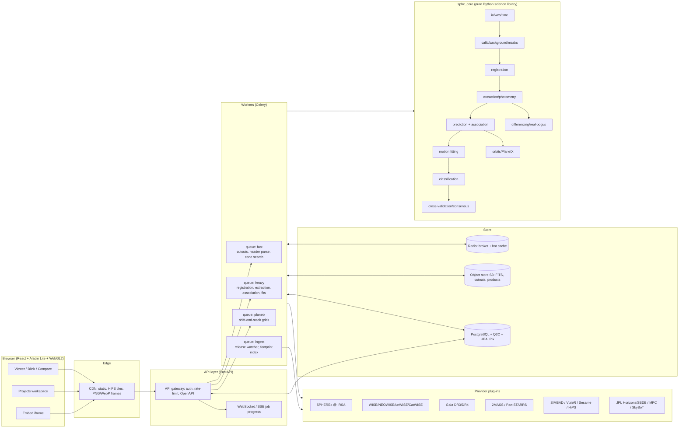
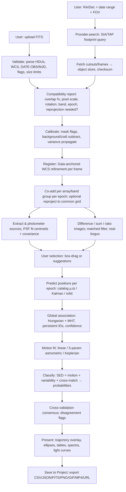
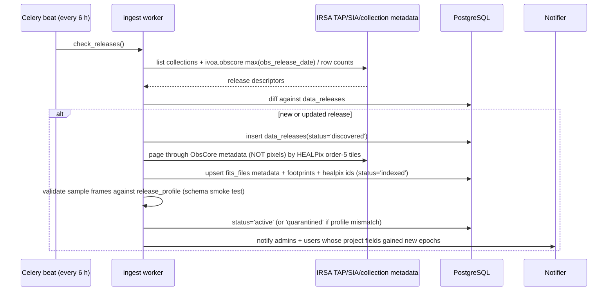

# ARCHITECTURE: Spec Section 6.1 (System) + 6.2-Backend

> Status: Stage-0 proposal (Opus spec, 2026-11-11). Items marked **[verify]** must be checked against official IRSA/SPHEREx documentation before implementation.
> Related: science → `SCIENCE.md`, schema → `DATA_MODEL.md`, endpoints/sources → `API.md`, UI → `FRONTEND.md`.

---

## 1. Design principle

Every component answers: *does this help the user detect, confirm and measure real motion more accurately and more easily?* Consequences:
1. **Archive is the source of truth.** We never mirror the full SPHEREx archive; we fetch cutouts/frames on demand, cache them, and persist only *derived* products (calibrated cutouts, detections, measurements, fits) with full provenance.
2. **Science core is a pure, testable library** (`sphx_core`) with no web/DB imports. Web services and workers wrap it. This keeps the science auditable and reproducible offline on `tests/fixtures/`.
3. **Every number has an uncertainty and provenance** (data release, software version, parameters hash).

---

## 2. Component overview



### 2.1 Components

| Component | Responsibility | Tech |
|---|---|---|
| Web client | Viewer, blink "little video", compare, overlays, spectra, projects | React 18 + TS strict, Vite, Aladin Lite v3, WebGL2 canvas, Zustand, TanStack Query, Observable Plot / uPlot |
| API gateway | REST (OpenAPI 3.1), auth, quotas, request validation (Pydantic v2) | FastAPI, Uvicorn/Gunicorn |
| Job progress | Push job state to client | Server-Sent Events (fallback polling) |
| Workers | All heavy compute; idempotent tasks keyed by params-hash | Celery 5 + Redis broker (RQ acceptable alternative) |
| `sphx_core` | Science algorithms (see SCIENCE.md) | Python 3.11+, NumPy, SciPy, Astropy ≥6, photutils ≥1.12, SEP, reproject, astroquery, pyvo, scikit-learn, emcee |
| Provider plug-ins | Uniform access to archives | `providers/` package, entry-point registry |
| Release watcher | Detect & ingest new data releases | Celery beat (cron) |
| PostgreSQL | Metadata, sources, measurements, projects | PG 16 + Q3C extension + `healpix_ipix` bigint columns (+ PostGIS optional for polygons) |
| Object store | FITS, cutouts, stacks, difference images, exports | S3-compatible (MinIO locally) |
| Redis | Broker, result backend, hot cache (cone results, header summaries) | Redis 7 |
| Observability | Traces, metrics, logs, science-QA | OpenTelemetry → Prometheus/Grafana, Sentry |

---

## 3. Data flow (main pipeline)



Every arrow is a persisted, versioned artifact (`processing_jobs` + `provenance` rows) so any result can be reproduced and audited.

---

## 4. Provider abstraction (new missions / releases without core changes)

```python
# backend/app/providers/base.py
from abc import ABC, abstractmethod
from dataclasses import dataclass
from astropy.coordinates import SkyCoord
from astropy.time import Time
import astropy.units as u

@dataclass(frozen=True)
class FrameRef:
    provider: str            # "spherex_irsa"
    release: str             # "QR-2026-10" / "DR1"  [verify naming]
    obs_id: str              # archive identifier
    access_url: str
    t_mid: Time              # mid-exposure, scale="tdb" after normalisation
    band_id: str | None      # e.g. "D3" array or channel id
    wavelength_um: tuple[float, float] | None   # coverage at the cutout centre
    footprint: list[tuple[float, float]]        # ICRS deg polygon

class Provider(ABC):
    name: str
    kind: set[str]           # {"images","catalog","ephemeris","spectra"}

    @abstractmethod
    def describe_releases(self) -> list[dict]: ...           # for release watcher
    def search_frames(self, c: SkyCoord, radius: u.Quantity,
                      t0: Time | None, t1: Time | None,
                      bands: list[str] | None) -> list[FrameRef]:
        raise NotImplementedError
    def fetch(self, ref: FrameRef, cutout: tuple[SkyCoord, u.Quantity] | None) -> bytes:
        raise NotImplementedError
    def cone(self, c: SkyCoord, radius: u.Quantity, epoch: Time | None = None):
        raise NotImplementedError                            # catalog providers
    def quality_mask(self, hdul) -> "np.ndarray[bool]":
        raise NotImplementedError                            # provider-specific flag semantics
```

- Registered via Python entry points `sphx.providers`. A new archive = new package; core untouched.
- **SPHEREx release specifics live only in `SpherexIrsaProvider` + a versioned `release_profiles/*.yaml`** (extension names, flag bit meanings, PSF layout, collection id). A new release with a changed layout = new YAML profile, not new code. [verify current IRSA collection ids, e.g. `spherex_qr`, and Level-2 MEF layout]

---

## 5. Ingestion of new SPHEREx releases ("easy to update")



- **Only metadata is indexed** (≈ 10⁶–10⁷ frame rows over mission life; small). Pixels are fetched lazily per request.
- Profile mismatch (new extension names, flag bits) → `quarantined`, admin alert, no silent use.
- Users see "New epoch available for this field" in their projects; re-running a trajectory fit creates a new version (old results preserved).
- Superseded releases (e.g. Quick Release → DR1 reprocessing) are kept; results record which release they used; UI offers "re-run on newer release".

---

## 6. Caching strategy

| Tier | What | Key | TTL / eviction |
|---|---|---|---|
| Browser | Frame tiles (WebP 8-bit display stretch + Float32 science tiles on demand), JSON | URL + ETag | immutable (content-hashed) |
| CDN | HiPS (CDS), rendered display frames, static app | content hash | 30 d |
| Redis hot | Cone-search results, header summaries, Horizons ephemerides | `prov:release:healpix9:radius:epoch` | 1–7 d LRU |
| Object store `cache/` | Raw cutouts from archives | `sha256(provider,obs_id,center,size)` | LRU, 30–90 d, size-capped |
| Object store `products/` | Calibrated cutouts, stacks, diffs, catalogs, fits | `params_hash` | permanent while referenced by a project; else 90 d |
| PostgreSQL | Detections/measurements | — | permanent (partitioned) |

Idempotency: each task's output key = `sha256(task_name, input_hashes, params, code_version, release)`. Re-requests hit the cache.

---

## 7. Job queue for heavy computation

| Queue | Typical tasks | Time budget | Concurrency |
|---|---|---|---|
| `fast` | header parse, cone, cutout fetch, display render | < 5 s | high |
| `heavy` | registration, co-add, extraction, association, fitting, classification, comparison | 5 s – 5 min | per-CPU |
| `planetx` | shift-and-stack over rate grids, injection-recovery | minutes – hours | low, preemptible, GPU optional (CuPy) |
| `ingest` | release watcher, metadata paging | background | 1–2 |

- Chains built with Celery canvas (`chain`/`chord`), each step persisted → resumable.
- Per-user quotas (anonymous: small FOV, no Planet X grids; logged-in: larger).
- Progress pushed through SSE `GET /api/v1/jobs/{id}/events`.

---

## 8. Scaling to a billion-object dataset

- We do **not** pre-extract all 10⁹ SPHEREx sources ourselves in MVP. Strategy:
  1. *On-demand fields*: extraction runs only for requested fields; results cached in `detections` (partitioned by HEALPix order-4, 3,072 partitions max; list-partitioned groups).
  2. *Official SPHEREx source catalogs* (when IRSA publishes them) are queried via TAP, not copied. [verify availability/timeline]
  3. Reference catalogs (Gaia, CatWISE) via TAP with Redis cache; optional local subset (Gaia DR3 G<19 ≈ 1.2 × 10⁹ rows is too big for MVP; use remote TAP + cache).
- Spatial indexing: Q3C (`q3c_ang2ipix(ra,dec)` btree, `q3c_radial_query`) for cones; `healpix_ipix` (order 9/≈ 6.9′ cells, nested) for tiling, partition pruning, and Planet X sky bookkeeping.
- Horizontal scaling: stateless API pods; worker autoscale on queue depth (KEDA); PG read replicas; object store scales natively.
- Display: HiPS for wide context (CDS SPHEREx HiPS if/when available [verify], else our own HiPS generated from co-adds via `hipsgen`/`reproject.hips` in Phase 2).

---

## 9. Tile / cutout services

- `GET /api/v1/cutouts?ra=&dec=&fov=&release=&band=&epoch=` → list of epoch frames (metadata + URLs).
- Each frame served as: (a) display WebP with stretch params in metadata; (b) science `float32` tile (`application/octet-stream` + JSON WCS) for client-side difference/sum without re-fetch; (c) original FITS cutout download.
- Server cutouts generated with `astropy.nddata.Cutout2D` (keeps WCS) or IRSA's native cutout service when supported for SPHEREx [verify].
- FOV limits: anonymous ≤ 15′ (fits ≤ ~150 px at 6.2″/px), logged-in ≤ 60′, admin/Planet X ≤ 3.5° (one array). Larger FOV ⇒ faster movers trackable (see SCIENCE §C.6), higher transfer cost (shown in UI).

---

## 10. Error handling

- Typed error envelope (RFC 9457 problem+json): `type`, `title`, `detail`, `science_impact` (e.g. "Epoch 3 dropped: 41% pixels flagged; proper-motion uncertainty increases 1.6×").
- Provider failures: retry with exponential backoff (3×), circuit breaker per provider, fallback chain (e.g. Gaia TAP @ ESA → Gaia @ VizieR/CDS → cached), and explicit UI notice. **Never** substitute fabricated data.
- Partial results allowed and labelled ("3 of 4 epochs").
- Upload validation errors are specific: "No celestial WCS", "DATE-OBS missing: supply epoch manually (will be flagged as user-supplied)".

## 11. Security

- FITS uploads: size cap (default 2 GB logged-in, 200 MB anonymous), `astropy.io.fits` opened with `memmap=True`, `lazy_load_hdus=True`, header card limit, no `fits.open` on compressed bombs without size precheck, parse in isolated worker container (seccomp, no network, read-only FS except tmp), antivirus optional (ClamAV).
- AuthN: email magic-link + ORCID OAuth (OIDC); sessions as HttpOnly SameSite=Lax cookies; API tokens (scoped, hashed) for programmatic use.
- AuthZ: project roles owner/editor/viewer; share links with signed, revocable tokens.
- Secrets only in env/secret manager. CSP strict; embed route has its own CSP `frame-ancestors *` and no cookies.
- Rate limiting per IP/token (Redis sliding window); outbound archive politeness limits (see API.md).
- Audit log of all writes (`audit_log` table).

## 12. Observability

- OpenTelemetry traces across API → worker → provider calls; Prometheus metrics: queue depth, task latency p50/p95, provider error rate, cache hit ratio.
- **Science-QA metrics** (dashboard + alerts): per-release astrometric residual RMS vs Gaia (mas) by array and magnitude; photometric zero-point scatter; fraction flagged pixels; nightly regression run of the 5 mandatory targets (SCIENCE §F) with pass/fail.
- Structured JSON logs; Sentry for exceptions (no PII).

---

## 13. Backend structure (Section 6.2, backend part)

### 13.1 Service / module breakdown

| Module | Responsibility | Key libs |
|---|---|---|
| `ingestion` | providers, release watcher, metadata indexing | pyvo, astroquery, requests |
| `fits_processing` | validation, header summary, masks, background, variance, co-add, reprojection | astropy, reproject, sep, photutils |
| `astrometry` | Gaia cross-match, WCS refinement (TAN-SIP fit), centroiding, per-epoch calibration | astropy.wcs.utils.fit_wcs_from_points, photutils.psf |
| `detection` | extraction, differencing (PSF-matched/ZOGY), matched filter, streaks, real-bogus | sep, photutils, scipy.ndimage, scikit-image, scikit-learn |
| `identity` | prediction, cost matrix, Hungarian/MHT association, persistent IDs | scipy.optimize.linear_sum_assignment, filterpy (Kalman) |
| `motion` | linear/5-param fits, MCMC, parallax factors | numpy, scipy, emcee |
| `classification` | SED templates, variability indices, reduced PM, Bayesian combiner | numpy, scikit-learn |
| `orbits` | Horizons/SBDB/SkyBoT/MPC checks, short-arc OD, Kepler solver, Planet X | astroquery.jplhorizons, astroquery.imcce, poliastro-like own code |
| `comparison` | A vs B ops, header diff, appeared/vanished/moved/varied lists | — |
| `projects` | projects, notes, findings, versions, sharing, exports | SQLAlchemy 2, Alembic |
| `auth` | users, sessions, tokens, ORCID | authlib |
| `api` | FastAPI routers, schemas, OpenAPI | FastAPI, Pydantic v2 |

### 13.2 Folder structure

```
docker-compose.yml          # local dev stack (db, redis, minio, api, worker, frontend)
/backend
  pyproject.toml
  app/
    main.py                 # FastAPI app factory
    api/v1/                 # routers: fields.py cutouts.py uploads.py objects.py tracks.py
                            #          compare.py planetx.py projects.py catalogs.py jobs.py embed.py
    schemas/                # Pydantic models (contract source of truth with OpenAPI)
    db/ models.py migrations/ (Alembic)
    workers/ celery_app.py tasks_fast.py tasks_heavy.py tasks_planetx.py tasks_ingest.py
    providers/ base.py spherex_irsa.py wise.py gaia.py twomass.py panstarrs.py
               simbad.py vizier.py horizons.py mpc.py skybot.py hips.py
               release_profiles/spherex_qr_v1.yaml
    services/               # thin orchestration around sphx_core
/science
  pyproject.toml
  sphx_core/                # pure science lib, no web/DB imports
    io/ wcs/ timeutil/ calib/ registration/ extraction/ difference/
    identity/ motion/ classify/ orbits/ planetx/ consensus/ comparison/
/tests
  fixtures/                 # tiny synthetic FITS (≤ 64×64) + header-only real samples
  unit/ integration/ science/   # science/ = 5 mandatory targets + injection tests
/frontend  (see FRONTEND.md)
/docs
/infra  backend.Dockerfile  frontend.Dockerfile  postgres/  # PHASE3: k8s/ terraform/
```

### 13.3 Storage layout (object store)

```
s3://sphx/
  raw/{provider}/{release}/{obs_id}.fits                 # only if user requested full frame
  cache/cutouts/{sha256}.fits                             # archive cutouts (LRU)
  uploads/{user_id}/{upload_id}/{original_name}.fits      # user uploads (private)
  products/{field_id}/{params_hash}/
      calib_{frame_id}.fits      # masked, bkg-subtracted, refined WCS, VARIANCE ext
      coadd_{epoch}_{arraygroup}.fits
      diff_{epochA}_{epochB}.fits  (+ SCORR, VARIANCE)
      catalog_{epoch}.parquet
      display/{frame}_{stretch}.webp
  exports/{project_id}/{version}/...csv|json|fits|png|gif|mp4
```

### 13.4 Workers & task contracts

Each task: `task(name, inputs: list[ArtifactRef], params: dict) -> list[ArtifactRef]`, deterministic, records `code_version` (git SHA), library versions, release ids, RNG seed. Endpoint list with request/response examples: see `API.md §3`.
