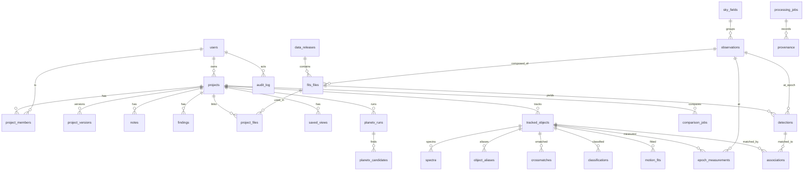

# DATA_MODEL: Spec Section 6.3 (Database schema)

PostgreSQL 16 + `q3c` extension (cone search) + nested HEALPix ids (`healpix9` = order 9, ≈ 6.9′ cells, 3,145,728 cells). PostGIS is optional, only for `sky_fields.footprint` polygon ops; alternative: `spoly` via pgSphere. All angles stored in **degrees (ICRS)**, times as **MJD (TDB)** `double precision` plus original UTC string; uncertainties in **mas** unless stated. Contract source of truth = Alembic migrations generated from `app/db/models.py`; this file mirrors them.

## 1. ER diagram



## 2. DDL

```sql
CREATE EXTENSION IF NOT EXISTS q3c;
CREATE EXTENSION IF NOT EXISTS pgcrypto;          -- gen_random_uuid()
-- optional: CREATE EXTENSION postgis;

-- ───────── Users & auth ─────────
CREATE TABLE users (
  id            uuid PRIMARY KEY DEFAULT gen_random_uuid(),
  email         citext UNIQUE NOT NULL,
  display_name  text,
  orcid         text UNIQUE,
  role          text NOT NULL DEFAULT 'user' CHECK (role IN ('user','scientist','admin')),
  settings      jsonb NOT NULL DEFAULT '{}',
  created_at    timestamptz NOT NULL DEFAULT now(),
  deleted_at    timestamptz
);
CREATE TABLE api_tokens (
  id uuid PRIMARY KEY DEFAULT gen_random_uuid(),
  user_id uuid NOT NULL REFERENCES users(id) ON DELETE CASCADE,
  token_hash bytea NOT NULL UNIQUE, scopes text[] NOT NULL, name text,
  created_at timestamptz DEFAULT now(), last_used_at timestamptz, revoked_at timestamptz
);

-- ───────── Projects workspace ─────────
CREATE TABLE projects (
  id uuid PRIMARY KEY DEFAULT gen_random_uuid(),
  owner_id uuid NOT NULL REFERENCES users(id),
  name text NOT NULL, description text,
  center_ra double precision, center_dec double precision, fov_arcmin real,
  visibility text NOT NULL DEFAULT 'private' CHECK (visibility IN ('private','link','public')),
  share_token_hash bytea,
  current_version int NOT NULL DEFAULT 1,
  created_at timestamptz DEFAULT now(), updated_at timestamptz DEFAULT now()
);
CREATE INDEX projects_owner_idx ON projects(owner_id);
CREATE INDEX projects_q3c_idx ON projects (q3c_ang2ipix(center_ra, center_dec));

CREATE TABLE project_members (
  project_id uuid REFERENCES projects(id) ON DELETE CASCADE,
  user_id uuid REFERENCES users(id) ON DELETE CASCADE,
  role text NOT NULL CHECK (role IN ('owner','editor','viewer')),
  PRIMARY KEY (project_id, user_id)
);
CREATE TABLE project_versions (            -- immutable snapshots for history/restore
  project_id uuid REFERENCES projects(id) ON DELETE CASCADE,
  version int NOT NULL,
  snapshot jsonb NOT NULL,                  -- ids of objects/fits/views/params at that version
  message text, created_by uuid REFERENCES users(id), created_at timestamptz DEFAULT now(),
  PRIMARY KEY (project_id, version)
);
CREATE TABLE notes (
  id uuid PRIMARY KEY DEFAULT gen_random_uuid(),
  project_id uuid NOT NULL REFERENCES projects(id) ON DELETE CASCADE,
  author_id uuid REFERENCES users(id), body_md text NOT NULL,
  attachments jsonb DEFAULT '[]',           -- viewer snapshots (URL state + PNG ref)
  created_at timestamptz DEFAULT now(), updated_at timestamptz DEFAULT now()
);
CREATE TABLE findings (
  id uuid PRIMARY KEY DEFAULT gen_random_uuid(),
  project_id uuid NOT NULL REFERENCES projects(id) ON DELETE CASCADE,
  tracked_object_id uuid,                   -- FK added below
  title text NOT NULL, summary_md text,
  status text NOT NULL DEFAULT 'draft' CHECK (status IN ('draft','candidate','submitted','known','rejected')),
  evidence jsonb NOT NULL DEFAULT '{}',     -- links to fits, classifications, consensus report
  external_ref text,                         -- e.g. MPC submission id, Backyard Worlds id
  created_at timestamptz DEFAULT now()
);
CREATE TABLE saved_views (
  id uuid PRIMARY KEY DEFAULT gen_random_uuid(),
  project_id uuid REFERENCES projects(id) ON DELETE CASCADE,
  name text, url_state text NOT NULL, params jsonb, created_at timestamptz DEFAULT now()
);

-- ───────── Data releases, fields, observations, files ─────────
CREATE TABLE data_releases (
  id text PRIMARY KEY,                      -- 'spherex_qr_2026-10', 'gaia_dr3'
  provider text NOT NULL, mission text NOT NULL,
  version_label text, release_date date,
  status text NOT NULL CHECK (status IN ('discovered','indexing','indexed','active','quarantined','superseded')),
  profile_name text,                         -- release_profiles/*.yaml
  supersedes text REFERENCES data_releases(id),
  n_frames bigint, notes text, discovered_at timestamptz DEFAULT now()
);
CREATE TABLE sky_fields (                   -- a user/project field or Planet X tile
  id uuid PRIMARY KEY DEFAULT gen_random_uuid(),
  center_ra double precision NOT NULL, center_dec double precision NOT NULL,
  radius_deg real NOT NULL,
  footprint jsonb,                          -- ICRS polygon [[ra,dec],...]; or geography if PostGIS
  healpix9 bigint NOT NULL,
  created_at timestamptz DEFAULT now()
);
CREATE INDEX sky_fields_q3c ON sky_fields (q3c_ang2ipix(center_ra, center_dec));

CREATE TABLE observations (                 -- one "epoch": frames of a field within a visit window
  id uuid PRIMARY KEY DEFAULT gen_random_uuid(),
  sky_field_id uuid NOT NULL REFERENCES sky_fields(id) ON DELETE CASCADE,
  release_id text REFERENCES data_releases(id),
  epoch_label text,                          -- 'S1', 'S2', or user label
  mjd_tdb_start double precision, mjd_tdb_end double precision,
  mjd_tdb_mean double precision NOT NULL,    -- flux-weighted mean epoch used for astrometry
  obs_bary_xyz_au double precision[3],       -- observer barycentric position (ICRS, au) at mean epoch
  n_frames int, coadd_ref text,              -- object-store key of epoch co-add(s)
  quality jsonb                              -- flagged fraction, astrometric RMS, zp scatter
);
CREATE INDEX observations_field_idx ON observations(sky_field_id, mjd_tdb_mean);

CREATE TABLE fits_files (
  id uuid PRIMARY KEY DEFAULT gen_random_uuid(),
  origin text NOT NULL CHECK (origin IN ('archive','upload','derived')),
  release_id text REFERENCES data_releases(id),
  provider text, obs_id text,               -- archive identifier
  uploader_id uuid REFERENCES users(id),
  observation_id uuid REFERENCES observations(id),
  storage_path text NOT NULL, sha256 bytea NOT NULL, size_bytes bigint NOT NULL,
  mission text, instrument text,
  array_id smallint,                         -- SPHEREx detector 1..6
  band_label text,                           -- channel or filter name
  wavelength_min_um real, wavelength_max_um real, wavelength_center_um real,
  date_obs_utc text, mjd_tdb_mid double precision, exptime_s real,
  ra_center double precision, dec_center double precision,
  naxis1 int, naxis2 int, pixscale_arcsec real, rotation_deg real,
  wcs_header text NOT NULL,                  -- serialized WCS (incl. SIP)
  wcs_refined text,                          -- after Gaia refinement
  astrometric_rms_mas real, n_astrom_ref int,
  footprint jsonb, healpix9 bigint,
  header_summary jsonb NOT NULL,             -- selected keys, all HDUs listed
  flags_summary jsonb,                        -- per-bit flagged fractions
  validation jsonb,                           -- compatibility report
  created_at timestamptz DEFAULT now(),
  UNIQUE (provider, obs_id, sha256)
);
CREATE INDEX fits_q3c ON fits_files (q3c_ang2ipix(ra_center, dec_center));
CREATE INDEX fits_time ON fits_files (mjd_tdb_mid);
CREATE INDEX fits_hpx ON fits_files (healpix9);
CREATE INDEX fits_array_band ON fits_files (array_id, wavelength_center_um);

CREATE TABLE project_files (
  project_id uuid REFERENCES projects(id) ON DELETE CASCADE,
  fits_file_id uuid REFERENCES fits_files(id),
  role text DEFAULT 'input', added_at timestamptz DEFAULT now(),
  PRIMARY KEY (project_id, fits_file_id)
);

-- ───────── Detections (partitioned) ─────────
CREATE TABLE detections (
  id bigint GENERATED ALWAYS AS IDENTITY,
  healpix4 smallint NOT NULL,                -- partition key (order 4: 3072 cells)
  fits_file_id uuid NOT NULL,                -- or coadd product
  observation_id uuid,
  ra double precision NOT NULL, dec double precision NOT NULL,
  x_pix real, y_pix real,
  sig_ra_mas real, sig_dec_mas real, corr_radec real,
  flux_ujy real, flux_err_ujy real, mag_ab real,
  snr real, fwhm_arcsec real, elongation real, theta_deg real,
  psf_chi2 real, sharpness real, roundness real,
  flags int NOT NULL DEFAULT 0,              -- bitmask (see §3)
  real_bogus real,                            -- 0..1
  is_difference bool NOT NULL DEFAULT false,  -- detected in A−B
  diff_sign smallint,                         -- +1/-1 for difference detections
  created_at timestamptz DEFAULT now(),
  PRIMARY KEY (healpix4, id)
) PARTITION BY LIST (healpix4);
-- partitions created in groups (e.g. 48 partitions × 64 cells) by migration script
CREATE INDEX detections_q3c ON detections (q3c_ang2ipix(ra, dec));
CREATE INDEX detections_file ON detections (fits_file_id);

-- ───────── Tracked objects & identity ─────────
CREATE TABLE tracked_objects (
  id uuid PRIMARY KEY DEFAULT gen_random_uuid(),
  project_id uuid REFERENCES projects(id) ON DELETE CASCADE,
  label text NOT NULL,                        -- 'A','B',... persistent within project
  public_id text UNIQUE,                      -- 'SPHX J085510.83-071442.5' style once stable
  selection_mode text CHECK (selection_mode IN ('box','suggestion','catalog','manual','planetx')),
  ref_ra double precision, ref_dec double precision, ref_mjd_tdb double precision,
  status text DEFAULT 'active' CHECK (status IN ('active','lost','merged','split','rejected')),
  merged_into uuid REFERENCES tracked_objects(id),
  identity_confidence real,                   -- min/mean of association confidences
  created_at timestamptz DEFAULT now(),
  UNIQUE (project_id, label)
);
ALTER TABLE findings ADD FOREIGN KEY (tracked_object_id) REFERENCES tracked_objects(id);

CREATE TABLE object_aliases (
  tracked_object_id uuid REFERENCES tracked_objects(id) ON DELETE CASCADE,
  catalog text NOT NULL, catalog_id text NOT NULL,   -- 'gaia_dr3','catwise2020','simbad','mpc'
  PRIMARY KEY (tracked_object_id, catalog, catalog_id)
);

CREATE TABLE associations (                   -- one row per (object, epoch) hypothesis
  id bigint GENERATED ALWAYS AS IDENTITY PRIMARY KEY,
  tracked_object_id uuid NOT NULL REFERENCES tracked_objects(id) ON DELETE CASCADE,
  observation_id uuid NOT NULL REFERENCES observations(id),
  detection_healpix4 smallint, detection_id bigint,  -- null = no detection (upper limit)
  pred_ra double precision, pred_dec double precision, pred_cov_mas2 real[4],
  cost real, mahalanobis_d2 real, flux_term real, color_term real, shape_term real, catalog_term real,
  confidence real NOT NULL,                   -- posterior probability of correct match
  rank smallint NOT NULL,                     -- 1 = chosen; >1 alternatives
  is_chosen bool NOT NULL,
  decided_by text NOT NULL CHECK (decided_by IN ('auto','user')),
  user_id uuid REFERENCES users(id), reason text,
  flags int DEFAULT 0,                         -- AMBIGUOUS, BLEND, EDGE, LOST, ...
  created_at timestamptz DEFAULT now()
);
CREATE INDEX assoc_obj_epoch ON associations(tracked_object_id, observation_id) WHERE is_chosen;

CREATE TABLE epoch_measurements (
  id bigint GENERATED ALWAYS AS IDENTITY PRIMARY KEY,
  tracked_object_id uuid NOT NULL REFERENCES tracked_objects(id) ON DELETE CASCADE,
  observation_id uuid REFERENCES observations(id),
  source text NOT NULL,                        -- 'spherex','gaia_dr3','catwise','2mass','user'
  mjd_tdb double precision NOT NULL,
  ra double precision, dec double precision,
  sig_ra_mas real, sig_dec_mas real, corr_radec real,   -- sig_ra is σ(α cosδ)
  band_group text, flux_ujy real, flux_err_ujy real,
  is_upper_limit bool DEFAULT false,
  flags int DEFAULT 0,
  used_in_fit bool DEFAULT true, outlier_reason text
);
CREATE INDEX em_obj_time ON epoch_measurements(tracked_object_id, mjd_tdb);

CREATE TABLE motion_fits (
  id uuid PRIMARY KEY DEFAULT gen_random_uuid(),
  tracked_object_id uuid NOT NULL REFERENCES tracked_objects(id) ON DELETE CASCADE,
  model text NOT NULL CHECK (model IN ('static','linear','astrometric5','astrometric5_prior','keplerian','shift_stack')),
  ref_epoch_mjd_tdb double precision NOT NULL,
  params jsonb NOT NULL,                       -- {ra0,dec0,pmra,pmdec,plx} or orbital elements
  covariance double precision[] NOT NULL,       -- row-major n×n
  pm_total_masyr real, pm_total_err real, pa_deg real, pa_err real,
  rate_arcsec_hr real,                          -- for SSOs
  plx_mas real, plx_err real, dist_pc real, vtan_kms real,
  chi2 real, dof int, chi2_red real, bic real,
  residuals jsonb, method text,                 -- 'wls','mcmc','bk'
  n_epochs int, baseline_yr real,
  is_preferred bool DEFAULT false,
  created_at timestamptz DEFAULT now()
);

CREATE TABLE classifications (
  id uuid PRIMARY KEY DEFAULT gen_random_uuid(),
  tracked_object_id uuid NOT NULL REFERENCES tracked_objects(id) ON DELETE CASCADE,
  method text NOT NULL,                         -- 'sed','motion','variability','xmatch','consensus'
  probabilities jsonb NOT NULL,                 -- {"star_pm":0.1,"brown_dwarf":0.8,...} sums to 1
  top_class text NOT NULL, top_prob real NOT NULL,
  evidence jsonb NOT NULL,                      -- features + values + contributions
  disagreements jsonb,                          -- for consensus rows
  created_at timestamptz DEFAULT now()
);

CREATE TABLE crossmatches (
  id bigint GENERATED ALWAYS AS IDENTITY PRIMARY KEY,
  tracked_object_id uuid REFERENCES tracked_objects(id) ON DELETE CASCADE,
  catalog text NOT NULL, catalog_release text, catalog_id text,
  sep_arcsec real, sep_after_pm_arcsec real,     -- after propagating catalog μ,ϖ to our epoch
  match_prob real, payload jsonb,               -- catalog row subset
  created_at timestamptz DEFAULT now()
);

CREATE TABLE spectra (
  id uuid PRIMARY KEY DEFAULT gen_random_uuid(),
  tracked_object_id uuid REFERENCES tracked_objects(id) ON DELETE CASCADE,
  observation_id uuid REFERENCES observations(id),
  wavelength_um real[] NOT NULL, flux_ujy real[] NOT NULL, flux_err_ujy real[] NOT NULL,
  mjd_tdb real[] NOT NULL,                      -- each channel's own epoch (LVF!)
  flags int[] NOT NULL, method text,           -- 'forced_psf'
  storage_path text,                            -- optional parquet/FITS copy
  created_at timestamptz DEFAULT now()
);

-- ───────── Comparison & Planet X ─────────
CREATE TABLE comparison_jobs (
  id uuid PRIMARY KEY DEFAULT gen_random_uuid(),
  project_id uuid REFERENCES projects(id) ON DELETE CASCADE,
  fits_a uuid NOT NULL REFERENCES fits_files(id), fits_b uuid NOT NULL REFERENCES fits_files(id),
  ops text[] NOT NULL,                          -- {'diff','sum','ratio','header_diff','sources'}
  params jsonb, status text, products jsonb,    -- object-store keys
  header_diff jsonb, source_changes jsonb,      -- appeared/disappeared/moved/varied
  processing_job_id uuid, created_at timestamptz DEFAULT now()
);
CREATE TABLE planetx_runs (
  id uuid PRIMARY KEY DEFAULT gen_random_uuid(),
  project_id uuid REFERENCES projects(id) ON DELETE CASCADE,
  sky_field_id uuid REFERENCES sky_fields(id),
  grid jsonb NOT NULL,                          -- distance range, rate/PA grid, step sizes
  epochs uuid[] NOT NULL, status text,
  depth_5sigma_ab real, n_hypotheses bigint, false_alarm_expected real,
  injection_recovery jsonb,                     -- efficiency vs mag/rate
  processing_job_id uuid, created_at timestamptz DEFAULT now()
);
CREATE TABLE planetx_candidates (
  id uuid PRIMARY KEY DEFAULT gen_random_uuid(),
  run_id uuid NOT NULL REFERENCES planetx_runs(id) ON DELETE CASCADE,
  ra double precision, dec double precision, mjd_tdb_ref double precision,
  rate_arcsec_hr real, pa_deg real, dist_au_range real[2],
  snr_stack real, n_epochs_detected int, stamps_path text,
  known_object text,                             -- MPC/Horizons match if any
  vetting jsonb, status text DEFAULT 'candidate' CHECK (status IN ('candidate','rejected','known','followup'))
);

-- ───────── Jobs, provenance, audit ─────────
CREATE TABLE processing_jobs (
  id uuid PRIMARY KEY DEFAULT gen_random_uuid(),
  user_id uuid REFERENCES users(id), project_id uuid REFERENCES projects(id),
  task text NOT NULL, queue text NOT NULL, params jsonb NOT NULL, params_hash bytea NOT NULL,
  status text NOT NULL CHECK (status IN ('queued','running','succeeded','failed','cancelled')),
  progress real, error jsonb, outputs jsonb,
  started_at timestamptz, finished_at timestamptz, created_at timestamptz DEFAULT now()
);
CREATE INDEX jobs_hash ON processing_jobs(params_hash);
CREATE TABLE provenance (
  id bigint GENERATED ALWAYS AS IDENTITY PRIMARY KEY,
  processing_job_id uuid REFERENCES processing_jobs(id),
  entity_table text NOT NULL, entity_id text NOT NULL,
  inputs jsonb NOT NULL,                        -- [{table,id,sha256}]
  code_version text NOT NULL, lib_versions jsonb NOT NULL,
  release_ids text[], params jsonb, rng_seed bigint,
  created_at timestamptz DEFAULT now()
);
CREATE INDEX prov_entity ON provenance(entity_table, entity_id);
CREATE TABLE audit_log (
  id bigint GENERATED ALWAYS AS IDENTITY PRIMARY KEY,
  user_id uuid REFERENCES users(id), action text NOT NULL,
  entity_table text, entity_id text, before jsonb, after jsonb,
  ip inet, created_at timestamptz DEFAULT now()
);
```

## 3. Flag bitmasks (`detections.flags`, `epoch_measurements.flags`, `associations.flags`)

| Bit | Name | Meaning |
|---|---|---|
| 0 | SATURATED | any core pixel saturated / nonlinear (from FLAGS ext) |
| 1 | BLENDED | deblended from ≥ 2 components |
| 2 | EDGE | within 2 FWHM of image edge / masked region |
| 3 | BAD_PIX | bad/hot pixel inside aperture |
| 4 | COSMIC | CR/transient hit in core |
| 5 | PERSIST | persistence suspected |
| 6 | GHOST_SPIKE | ghost / diffraction spike / scattered-light mask |
| 7 | LOW_SNR | S/N < 5 |
| 8 | EXTENDED | resolved (galaxy/comet coma) |
| 9 | STREAK | elongated along motion |
| 10 | USER_EPOCH | epoch supplied by user (no DATE-OBS) |
| 11 | REPROJECTED | measured on resampled data (correlated noise) |
| 16 | AMBIGUOUS_MATCH | association confidence < 0.9 or ≥ 2 hypotheses within Δcost < 2 |
| 17 | LOST | no detection in gate (upper limit) |
| 18 | MERGED | merged with another tracked object at this epoch |
| 19 | USER_OVERRIDE | user corrected match |
| 20 | DUPLICATE_PROPOSAL | proposed duplicate trajectory track candidate |
| 21 | PM_OUTLIER | dropped astrometric/proper-motion outlier epoch |
| 22 | VIM_CANDIDATE | variability-induced motion photocentre wobble candidate |

SPHEREx-native FLAGS bits are mapped to these via the release profile YAML [verify native bit definitions].

## 4. Indexing & partitioning notes
- Cone search: `WHERE q3c_radial_query(ra, dec, :ra0, :dec0, :r_deg)`; cross-match: `q3c_join`.
- `detections` list-partitioned by `healpix4` groups → pruning for field queries; partition maintenance script in `/infra`.
- Hot paths: `(tracked_object_id, mjd_tdb)`, `(sky_field_id, mjd_tdb_mean)`, `params_hash`.
- Expected sizes (Public phase, 10⁵ user fields × ~10³ sources × 6 epochs): ~6 × 10⁸ detection rows ≈ 120 GB; fine on one primary + replicas.
