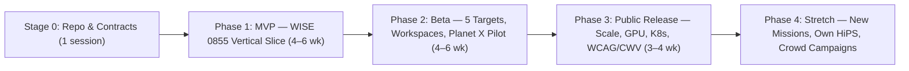

# ROADMAP: Spec Section 6.6 (Phased Plan, Backlog, Risks, Testing, Metrics)

> Status: Stage-0 specification (2026-11-11). Aligns Master Prompt §3/§6.6 with `Agents.md` §4 (MVP vs Phase 2 constraints) and §5 (model routing).

---

## 1. Phase overview

- **Stage 0 (Foundation):** Monorepo skeleton, Docker Compose (PG 16, Redis 7, MinIO), Alembic baseline, FastAPI/OpenAPI contract, synthetic ≤ 64×64 FITS fixtures, `reference_values.json` schema.
- **Phase 1 (MVP — Vertical Slice):** End-to-end flow for **WISE 0855−0714** (plus core upload, RA/Dec query, array 1–6 co-adds, WebGL2 "little video" blink, box-drag + suggested objects, persistent cross-epoch IDs, linear/5-param motion fit, on-the-fly SED, Gaia/CatWISE overlays, basic A-vs-B compare, URL/iframe embed, anonymous viewer + email/password projects).
- **Phase 2 (Beta — Full Science & Workspaces):** All **5 mandatory targets** automated in CI (`Barnard's Star`, `ε Indi B`, `WISE 0855`, `RW Aurigae`, `R Draconis`), ZOGY differencing, VIM check, single-FITS streak/intra-visit tracking, SSO linking (SkyBoT/Horizons/MPC), full Project workspace (notes, findings, versions, exports), automated 6-h IRSA release watcher, Planet X pilot (CPU on single tile), plus Phase 2 DB/auth upgrades (Q3C, ORCID + magic-link, OTel/Prometheus).
- **Phase 3 (Public Release):** Kubernetes + KEDA autoscaling, CuPy/GPU Planet X grid, WebCodecs MP4 export, PG read replicas, ClamAV upload scanning, full WCAG 2.2 AA & Core Web Vitals optimization, editorial/SSG pages (`About`, `Methodology`, `Examples`, `Docs`, `Credits`, `FAQ`).
- **Phase 4 (Stretch):** Own HiPS generation (`reproject.hips`), Rubin/Euclid/Roman provider plug-ins, Gaia DR4 catalog migration, citizen-science collaborative vetting queues.

---

## 2. Feature backlog ("may consider" items + `Agents.md` §4 staging)

Every item from Master Prompt §3 and `Agents.md` §4 is assigned a phase. Deferred items state their MVP substitute and justification.

| Feature | Tag | MVP substitute (if deferred) | Justification |
|---|---|---|---|
| Easy updates for new SPHEREx releases (Provider ABC + `release_profiles/*.yaml`) | **MVP** | Manual admin CLI trigger to index new release | Isolates format changes in YAML without delaying MVP |
| Automated 6-h IRSA ObsCore release watcher + project alerts | **Beta** | Manual index refresh | Cron watcher adds operational surface not needed for first slice |
| Creative 102-band display (per-array 1–6 co-adds, RGB composite, CH₄/CO₂ ratio) | **MVP** | — | Core to spotting cool dwarfs like WISE 0855 (invisible < 3.5 µm) |
| On-the-fly spectra generation (forced PSF SED across 102 channels) | **MVP** (core) / **Beta** (templates + temporal spread) | Raw flux vs λ plot in MVP; template fits + multi-epoch compare in Beta | Spectral verification prevents mistaking red variables/artifacts for dwarfs |
| Add/subtract images across epochs (`A+B`, `A−B`, ratio) | **MVP** | Client WebGL2 `A−B`/`A+B`/`A÷B` + basic server diff; ZOGY in Beta | Immediate visual mover & variable discrimination |
| User-selectable FOV (transfer-time vs fast-mover rate indicator) | **MVP** (2′–60′) / **Beta** (3.5° array) | Clamped ≤ 15′ anon, ≤ 60′ logged-in in MVP | Bounds memory/bandwidth while keeping WISE 0855 (3.5′ shift) inside field |
| Multi-telescope overlays (Gaia, WISE/CatWISE) | **MVP** | Gaia DR3 + CatWISE2020 overlays | Essential for astrometric tie & non-SPHEREx baseline |
| Additional catalog overlays (2MASS, Pan-STARRS, SIMBAD, SkyBoT/MPC SSOs) | **Beta** | URL links to CDS/SIMBAD in inspector | Reduces external TAP rate-limit complexity in MVP |
| Coordinates-in-URL query & `/embed` iframe + oEmbed | **MVP** | — | Low implementation cost, core sharing/bookmarking requirement |
| Contamination flags & metadata panel | **MVP** | — | Non-negotiable scientific honesty requirement |
| Astropy/Astroquery/photutils/SEP/reproject + Aladin Lite v3 stack | **MVP** | — | Library-first baseline (`Agents.md` §2.1) |
| Auth: anonymous viewer + email/password for projects | **MVP** | Standard Argon2 email/password | Simpler than OIDC/magic-link for initial deployment (`Agents.md` §4) |
| ORCID + email magic-link login | **Beta** | Email/password | Adds OIDC/SMTP infra; needed before public scientist onboarding |
| Spatial index: HEALPix order-9 + RA/Dec B-tree | **MVP** | `BETWEEN` on RA/Dec + `healpix9` column | Avoids compiling PostgreSQL `q3c` C-extension in Stage 0 (`Agents.md` §4) |
| PostgreSQL Q3C extension + HEALPix-4 partitioning | **Beta** | HEALPix-9 B-tree | Needed once `detections` exceeds ~10⁶ rows |
| Planet X search mode (shift-and-stack + B&K orbit constraints) | **Beta** (CPU) / **Public** (GPU) | Deferred past MVP | High compute cost; depends on stable registration, differencing, and MPC checks |
| OpenTelemetry + Prometheus + Grafana observability | **Beta** | Structured JSON logs + `/health` + QA summary | Ops overhead deferred until multi-user Beta |
| WebCodecs client MP4 export | **Public** | PNG / animated GIF export (server/client) | Browser codec edge cases; GIF/PNG suffice for MVP/Beta |
| ClamAV upload scanning | **Public** | Size caps, header validation, seccomp no-net worker | Seccomp isolation already protects FITS parsing |
| Kubernetes + KEDA + PG read replicas + CuPy/GPU | **Public** | Docker Compose + single PG + Celery workers | Premature orchestration before load testing |
| Own HiPS tile generation (`reproject.hips`) | **Stretch** | CDS HiPS + custom WebGL2 cutouts | CDS HiPS covers context; custom HiPS only needed at massive scale |

---

## 3. Milestones & task breakdown

Model routing per `Agents.md` §5: **Opus 5.5** (spec/audit), **Sonnet 5.5** (`sphx_core/` science code & review), **Gemini 3.8 Flash High** (scaffolding, UI, API, DB, providers, tests, docs, deploy, shrink).

| ID | Task | Phase | Deps | Owner / Model | Effort (d) | Deliverable / DoD |
|---|---|---|---|---|---|---|
| T0.1 | Monorepo scaffold, `pyproject.toml`, `package.json`, Docker Compose (PG, Redis, MinIO) | Stage 0 | — | Flash High | 1 | `docker compose up` healthy; pytest & vitest run empty suite |
| T0.2 | Alembic initial schema (MVP tables, `healpix9` indexes, flags) + FastAPI `/health`, OpenAPI | Stage 0 | T0.1 | Flash High | 1 | `alembic upgrade head` passes; OpenAPI JSON validates |
| T0.3 | Synthetic FITS fixtures (≤ 64×64) + pinned `tests/science/reference_values.json` | Stage 0 | T0.1 | Flash High + Scientist | 1 | Fixtures load in `astropy.io.fits`; 5 target refs documented |
| T1.1 | `sphx_core`: `io`, `wcs`, `timeutil`, `calib` (masks, Background2D, variance, array co-adds) | MVP | T0.3 | Sonnet 5.5 | 3 | Unit tests on synthetic FITS pass; correlated noise measured |
| T1.2 | `sphx_core`: `registration` (Gaia-anchored TAN-SIP) + `extraction` (SEP + PSF centroids) | MVP | T1.1 | Sonnet 5.5 | 3 | Astrometric residual test ≤ 0.15″ on synthetic Gaia stars |
| T1.3 | `sphx_core`: `identity` (Kalman + Hungarian + Murty confidence) + `motion` (WLS 5-param) | MVP | T1.2 | Sonnet 5.5 | 3 | Crowded-field synthetic identity accuracy ≥ 99% at S/N ≥ 10 |
| T1.4 | `sphx_core`: `classify` (on-the-fly SED + Bayesian combiner) + `consensus` (E1–E6) | MVP | T1.3 | Sonnet 5.5 | 2 | WISE 0855 synthetic/real test passes `SCIENCE.md §F.3` |
| T1.5 | Providers: `SpherexIrsaProvider` (`spherex_qr_v1.yaml`), `GaiaProvider`, `WiseProvider`, `Sesame` | MVP | T0.2 | Flash High | 3 | Recorded-cassette integration tests pass; `[verify]` items checked |
| T1.6 | Backend API routers (`/fields`, `/cutouts`, `/uploads`, `/analyses`, `/objects`, `/compare`, `/projects`, `/auth`) + Celery workers | MVP | T1.4, T1.5 | Flash High | 4 | FastAPI + Celery integration tests pass; compatibility report works |
| T1.7 | Frontend design tokens, layout, Home, Viewer (`/v` + `/embed`), WebGL2 blink/diff, Aladin Lite, box-drag, inspector, spectrum panel, URL sync | MVP | T1.6 | Flash High | 6 | Playwright WISE 0855 E2E passes; WCAG `axe-core` 0 critical violations |
| T1.8 | MVP Shrink Pass & Science Review | MVP | T1.7 | Sonnet 5.5 / Flash | 1 | All MVP tests pass after shrink; `STATUS.md` updated |
| T2.1 | `sphx_core`: ZOGY differencing, matched filter, Real–Bogus GBDT, VIM check (`RW Aur`) | Beta | T1.4 | Sonnet 5.5 | 3 | Injection–recovery recall ≥ 0.90, variable-as-mover FPR ≤ 1% |
| T2.2 | `sphx_core`: single-FITS streak filter + intra-visit tracklets + B&K/Gauss/Kepler orbits | Beta | T1.4 | Sonnet 5.5 | 3 | SkyBoT known-asteroid residual < 3σ for ≥ 95% |
| T2.3 | Providers: `2MASS`, `PanSTARRS`, `SIMBAD`, `VizieR`, `Horizons`, `MPC`, `SkyBoT` + 6-h release watcher | Beta | T1.5 | Flash High | 3 | All provider cassette tests pass; watcher handles `quarantined` profile |
| T2.4 | `sphx_core`: Planet X shift-and-stack pilot (CPU, single 3.5° tile) + injection–recovery | Beta | T2.1, T2.2 | Sonnet 5.5 | 4 | Recovers synthetic distant movers & reports honest depth/efficiency |
| T2.5 | Full Project workspace UI (notes, findings, versions, exports), full A-vs-B compare UI, Planet X wizard, 5-target `/examples` gallery | Beta | T1.7, T2.3, T2.4 | Flash High | 5 | Playwright tests pass for all 5 mandatory targets |
| T2.6 | Upgrade PG to Q3C + HEALPix-4 partitioning, ORCID + magic-link auth, OTel/Prometheus/Grafana + nightly QA job | Beta | T1.6 | Flash High | 3 | `q3c_radial_query` verified; nightly 5-target QA dashboard green |
| T3.1 | Editorial/SSG pages (`About`, `Methodology` w/ KaTeX, `Docs`, `Credits`, `FAQ`, `Contact`, `Privacy/Terms`), CWV tuning | Public | T2.5 | Flash High | 3 | Landing LCP < 2.0 s (4G throttling), JS < 200 KB gz |
| T3.2 | WebCodecs MP4 export, CuPy/GPU Planet X runner, K8s + KEDA manifests, PG read replicas, ClamAV | Public | T2.6 | Flash High | 4 | Load test passes; GPU speedup ≥ 10× on Planet X tile |
| T3.3 | Final Security, Science & Architecture Audit | Public | T3.1, T3.2 | Opus 5.5 | 2 | Sign-off against `SPEC_INDEX.md` traceability checklist |

---

## 4. Testing strategy

| Layer | Scope & tools | Frequency | Pass bar |
|---|---|---|---|
| **Unit** | `pytest` on `sphx_core/` with tiny synthetic FITS (`tests/fixtures/`), `Vitest` on UI/URL-sync/GL shaders | Every commit | 100% pass; ≥ 85% coverage on `sphx_core` |
| **Integration** | FastAPI `TestClient`, Alembic migrations, Celery eager tasks, recorded archive HTTP cassettes (VCR/respx) | Every PR | 100% pass; zero unmocked external HTTP calls |
| **Science validation** | `tests/science/` against pinned `reference_values.json`: all 5 mandatory targets (`SCIENCE.md §F.3`), injection–recovery, crowded-field identity, Gaia residual QA, SkyBoT SSOs | Nightly + before any `sphx_core/` merge | Numeric thresholds in `SCIENCE.md §F.3` met |
| **End-to-End** | `Playwright`: coordinate entry, FITS upload mismatch warning, box-drag tracking, manual match override, A-vs-B compare, `/embed`, 5 target presets | PR to `main` + nightly | All E2E specs pass across Chromium/Firefox/WebKit |
| **Accessibility** | `@axe-core/playwright` + keyboard-only box-select & blink-player navigation test | PR to `main` | 0 serious/critical WCAG 2.2 AA violations |
| **Performance / Load** | `k6`/`Locust` API load (100 concurrent viewers); browser WebGL fps trace; bundle budget check | Pre-Beta & Pre-Public | p95 cached cutout < 1.5 s; blink ≥ 30 fps at 1024²; INP < 200 ms |

---

## 5. Risks & mitigations

| Category | Risk | Impact | Mitigation |
|---|---|---|---|
| **Archive / SPHEREx** | IRSA Level-2 MEF layout, flag bits, or collection IDs differ from assumptions (`[verify]` items) | Pipeline fails or misreads masks/wavelengths | Isolate all release details in `release_profiles/*.yaml`; smoke-test schema before activating any release (`quarantined` on mismatch) |
| **Astrometry** | Undersampled 6.2″ pixels + pixel-phase bias + blended background stars corrupt WISE 0855 or ε Indi B positions | False proper motion or lost identity | Empirical 5×5 sub-pixel phase table per release; forced multi-PSF deblending; 2MASS/WISE/Gaia long-baseline anchors; explicit systematic floor |
| **Science / Confusion** | Variable stars (`RW Aur`, `R Dra`) or VIM in unresolved pairs flagged as movers | False discoveries, loss of credibility | Monopole vs dipole ΔBIC > 10 test + VIM flux-centroid correlation check + multi-method consensus required |
| **External Rate Limits** | IRSA, ESA Gaia, CDS SIMBAD, or JPL Horizons throttle or go down during traffic spikes | Viewer stalls | Multi-tier cache (Redis + S3 cutouts + daily local MPCORB); circuit breakers; fallback mirrors (ESA → VizieR); polite worker rate limiters |
| **Compute Cost** | Planet X shift-and-stack grids exhaust worker CPU/memory | Queue starvation for normal viewer users | Dedicated `planetx` preemptible queue; logged-in quota only; NumPy CPU budget in Beta, CuPy/GPU in Public |
| **UX / Misinterpretation** | Users treat `candidate_new_mover` or `candidate_planet_x` as confirmed discoveries | Spurious MPC reports | UI badges, mandatory confidence & caveat panels, consensus disagreement locks on finding export, no auto-submission |

---

## 6. Success metrics

| Domain | Metric | MVP Target | Public Release Target |
|---|---|---|---|
| **Astrometry** | Single-epoch Gaia star residual RMS (16 < G < 18, S/N > 50) | ≤ 0.20″ | ≤ 0.12″ |
| **Proper motion** | Mandatory target μ error (with long-baseline anchors) | WISE 0855 within max(3σ, 1″/yr) | All 5 targets pass `SCIENCE.md §F.3` |
| **Detection** | Mover recall (injection–recovery, S/N ≥ 10, μ ≥ 5σ_μ) | ≥ 0.85 | ≥ 0.92 |
| **False positives** | Variable-star-as-mover FPR; empty-field false mover rate | ≤ 2% ; ≤ 0.02/field | ≤ 1% ; ≤ 0.01/field |
| **Identity** | Cross-epoch match accuracy (simulated crowded field, S/N ≥ 10) | ≥ 97% | ≥ 99% (100% errors flagged conf < 0.9) |
| **Classification** | Calibration Expected Calibration Error (ECE) on SIMBAD/Gaia set | ≤ 0.08 | ≤ 0.05 |
| **Latency** | Cached 10′ FOV first frame render; blink framerate | < 4 s ; ≥ 25 fps | < 2 s ; ≥ 30 fps (1024²) |
| **Accessibility** | WCAG 2.2 AA automated + keyboard audit | 0 critical bugs | 100% pass + screen-reader table parity |
